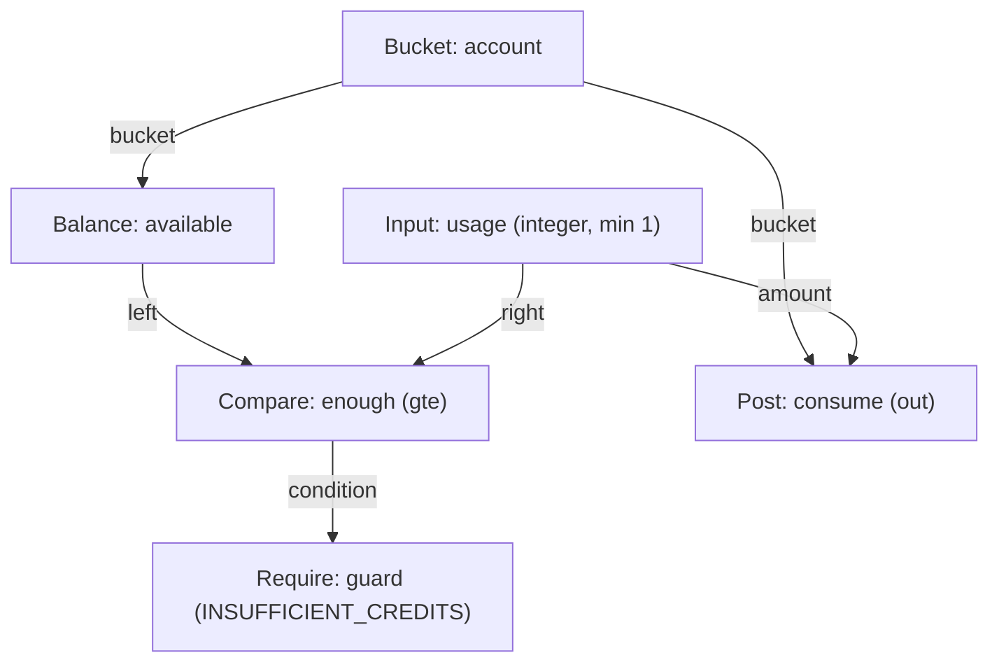

# Programs

A **template** is a published, immutable program describing one operation. This chapter is its complete specification.

```http
POST /v1/templates

{
  "id": "sell-banana",
  "domain": "banana-qty",
  "name": "sell-banana",
  "nodes": [ ... ]
}
```

## Execution model

A program is a **flat, ordered list of nodes**. Execution is sequential, one node at a time:

- every node has a unique `id` and runs **exactly once**;
- a node may reference **only earlier nodes** — references are backward, so the program is a DAG laid out in topological order;
- there are no loops, no recursion, no jumps and no user-defined nodes;
- `if`, `logic` and `compare` **select values**; they never skip nodes.

Only three things stop a program: a failed `require`, an incomplete required allocation, or an evaluation error (overflow, division by zero, missing bucket). Any of them rolls the whole operation back.

### Invoking a program

```http
POST /v1/transactions/execute/{template}
Idempotency-Key: <key>

{
  "context": { "bucket": "customer-a" },
  "inputs": { "amount": 350 },
  "effective_at": "2026-08-16T12:00:00Z",
  "metadata": { "order": "A-1029" }
}
```

`POST /v1/transactions/preview/{template}` takes the same body without the header and always rolls back.

### Context

A template belongs to a domain, and the execution context must sit inside that domain's subtree.

| Context | Meaning |
|:---|:---|
| `{"context":{"bucket":"user-a"}}` | The common case. `bucket` nodes resolve to this bucket. |
| `{"context":{"domain":"points"}}` | Cold bootstrap. A bare `bucket` node **fails**, since there is no context bucket; `provision` can open the first one. |
| omitted | Allowed only for a template on a **scalar** domain, which is then selected. Required for an organizational template domain. |

### Business time

`effective_at` is both the transaction's business time and the reference time for the program's reads. Date-windowed reads inside a backdated operation therefore agree with the write being created.

### Write-through and rollback

`provision`, `post` and allocation postings write **as their nodes run**, inside the operation's atomic transaction, and later `balance`, `attribute` and `allocate` nodes see those writes immediately. Any rejection or error rolls the entire operation back, including the transaction header and every bucket just provisioned. Preview uses the identical path and always rolls back.

## Values

Runtime values have four types:

| `value_type` | Notes |
|:---|:---|
| `integer` | Signed 64-bit. All amounts and attributes are integers. |
| `boolean` | Produced by `compare` and `logic`. |
| `bucket` | A bucket handle, supplied as a reference string. It **may address a bucket outside the context subtree** — authorizing what a program can touch is the template publisher's responsibility — though a granular token needs `unscoped_bucket_inputs` to reach past its own granted domains. |
| `reference` | A caller-supplied bucket *name*, consumed only by `provision`. It is never an addressable value: arithmetic and comparison nodes cannot see it. |

## Scopes

Every balance, provision and allocation names exactly one target, in exactly one of three shapes:

```json
{ "bucket": "bucket_node" }
{ "domain": "points" }
{ "domain_self": true }
```

`balance` accepts all three. `provision` and `allocate` require a **domain** scope (`domain` or `domain_self`).

## Node reference

| `op` | Required fields | Optional | Result |
|:---|:---|:---|:---|
| [`input`](#input) | `value_type` | `min`, `max` | Caller-supplied value |
| [`value`](#value) | `value_type`, `value` | — | Literal |
| [`clock`](#clock) | `source`, `unit` | `at` | Transaction timestamp in epoch seconds |
| [`bucket`](#bucket) | — | — | Context bucket |
| [`balance`](#balance) | `scope` | `since`, `until`, `since_sequence`, `until_sequence` | Integer |
| [`attribute`](#attribute) | `bucket`, `key` | `default` | Integer |
| [`math`](#math) | `operator`, `left`, `right` | `rounding` | Integer |
| [`compare`](#compare) | `operator`, `left`, `right` | — | Boolean |
| [`logic`](#logic) | `operator`, `left` | `right` | Boolean |
| [`if`](#if) | `condition`, `then`, `else` | — | Selected value |
| [`require`](#require) | `condition`, `code` | `message` | Rejects when false |
| [`post`](#post) | `bucket`, `amount`, `direction` | `when` | Posting |
| [`provision`](#provision) | `scope`, `reference` | `attributes` | Bucket |
| [`allocate`](#allocate) | `scope`, `order_by`, `limit`, `amount` | `filter`, `require`, `value` | Unallocated remainder |

Every node also carries `id`. Unknown fields are rejected at publication.

### `input`

```json
{ "id": "qty", "op": "input", "value_type": "integer", "min": 1, "max": 1000 }
```

`min` and `max` apply to integers only; a `reference` input rejects them. An input missing from the request, or out of range, fails the operation before any write.

### `value`

```json
{ "id": "today", "op": "value", "value_type": "integer", "value": 20260101 }
```

A literal baked into the program.

### `clock`

```json
{ "id": "now", "op": "clock", "source": "created_at", "unit": "second" }
{ "id": "week", "op": "clock", "source": "effective_at", "unit": "second", "at": "week_start" }
```

Reads the transaction's `created_at` (insertion time) or `effective_at` (business time) as a Unix epoch integer in seconds. `at` defaults to `instant`; `week_start` returns Monday at 00:00:00 UTC for the selected timestamp. Stored epoch milliseconds are converted to seconds explicitly. Backdating changes `effective_at`, not `created_at`.

### `bucket`

```json
{ "id": "account", "op": "bucket" }
```

Resolves to the execution context's bucket. Fails under domain context.

### `balance`

```json
{ "id": "available", "op": "balance", "scope": { "bucket": "account" } }
{ "id": "spent_today", "op": "balance", "scope": { "domain": "cash" }, "since": "today" }
```

Sums postings within the scope. Date bounds `since` / `until` are **inclusive** and accept:

- `now`, `today`, `yesterday`
- period starts (e.g. start-of-month/week markers)
- relative days: `-<n>d`
- ISO dates (`2026-01-31`) and RFC 3339 timestamps

Bucket-scoped balances may additionally use `since_sequence` / `until_sequence`, referencing nodes that yield sequence numbers, for inclusive slices of a bucket's own posting sequence.

### `attribute`

```json
{ "id": "cost", "op": "attribute", "bucket": "lot", "key": "unit_cost", "default": 0 }
```

Reads an immutable integer attribute. Without a `default`, a missing key is an error.

### `math`

```json
{ "id": "total", "op": "math", "operator": "mul", "left": "qty", "right": "price" }
{ "id": "share", "op": "math", "operator": "div", "left": "total", "right": "parts",
  "rounding": "half_even" }
```

Operators: `add`, `sub`, `mul`, `div`, `mod`, `min`, `max`. All arithmetic is checked — overflow and division or modulo by zero return an error carrying the failing node id.

`div` **requires** `rounding`; every other operator rejects the field.

| `rounding` | Behaviour |
|:---|:---|
| `trunc` | Toward zero |
| `floor` | Toward negative infinity |
| `ceil` | Toward positive infinity |
| `half_up` | Nearest, ties away from zero |
| `half_even` | Nearest, ties toward the even quotient |

There is no implicit rounding anywhere in Plinth.

### `compare`

```json
{ "id": "enough", "op": "compare", "operator": "gte", "left": "available", "right": "qty" }
```

Operators: `eq`, `ne`, `lt`, `lte`, `gt`, `gte`.

### `logic`

```json
{ "id": "ok", "op": "logic", "operator": "and", "left": "enough", "right": "active" }
{ "id": "blocked", "op": "logic", "operator": "not", "left": "ok" }
```

`and` and `or` are binary and require `right`; `not` is unary and rejects it.

### `if`

```json
{ "id": "rate", "op": "if", "condition": "is_member", "then": "member_rate",
  "else": "list_rate" }
```

Selects one of two already-computed values. Both branches have run — `if` chooses a result, it does not skip work.

### `require`

```json
{ "id": "guard", "op": "require", "condition": "enough", "code": "INSUFFICIENT_STOCK",
  "message": "not enough stock to fulfil the order" }
```

When the condition is false the operation is rejected and nothing is persisted. The API answers `422` with the guard reported structurally, so callers branch on fields instead of parsing prose:

```json
{
  "code": "rejected",
  "message": "not enough stock to fulfil the order",
  "rejection": "INSUFFICIENT_STOCK",
  "node": "guard"
}
```

`code` is the envelope's error code, the same on every rejection; `rejection` is the guard's own code and `node` its id. Without a `message` on the guard, the envelope falls back to `operation rejected by <code>`. In a batch the body also carries `operation`, the zero-based index of the operation that failed.

Guard codes match `^[A-Z][A-Z0-9_]{0,63}$`, so callers can branch on them safely.

### `post`

```json
{ "id": "debit", "op": "post", "bucket": "account", "amount": "qty", "direction": "out" }
{ "id": "bonus", "op": "post", "bucket": "account", "amount": "extra", "direction": "in",
  "when": "is_member" }
```

`direction` is **required**:

| `direction` | Behaviour |
|:---|:---|
| `auto` | Preserves the amount's sign |
| `in` | Requires a positive magnitude, posts it positive |
| `out` | Requires a positive magnitude, posts it negative |

Zero and `i64::MIN` are rejected by the shared posting guard. The optional `when` makes the posting conditional on a boolean node.

### `provision`

```json
{ "id": "lot", "op": "provision", "scope": { "domain_self": true },
  "reference": { "from": "input", "node": "lot_ref", "on_conflict": "reuse" },
  "attributes": { "expiry": "expiry", "unit_cost": "cost" } }
```

Opens a bucket on a scalar domain inside the template subtree and stamps immutable integer attributes, each taken from an earlier node.

The reference is one of:

| `reference` | Behaviour |
|:---|:---|
| `{"from":"generated"}` | A lowercase ULID derived from the transaction and the node — a distinct bucket every call, and the same one when the transaction is replayed. |
| `{"from":"input","node":"lot_ref","on_conflict":"fail"}` | Caller-named; a reference may be opened exactly once. A second attempt returns `409`. |
| `{"from":"input","node":"lot_ref","on_conflict":"reuse"}` | Caller-named; an existing bucket is reused, and later nodes post into it. |

`reuse` requires the existing bucket to belong to the same domain **and** carry identical attributes — reuse must never become a silent rewrite. A mismatch returns `409`.

The provisioned bucket is visible to every later node in the same operation, and disappears with a rollback.

### `allocate`

```json
{ "id": "consume", "op": "allocate", "scope": { "domain_self": true },
  "order_by": { "by": "attribute", "key": "expiry" },
  "filter": { "operator": "gte", "value": "today" },
  "limit": 5,
  "amount": "qty",
  "require": { "code": "INSUFFICIENT_STOCK" },
  "value": { "key": "unit_cost", "destination": "cogs", "direction": "out" } }
```

Consumes `amount` across a bounded set of the domain's buckets, posting out of each in turn. Its result is the **unallocated remainder**, which later nodes may read.

Like `provision`, the scoped domain must sit inside the template subtree; a domain outside it answers `404`.

- **`order_by`** — `{"by":"created_at"}` for FIFO, or `{"by":"attribute","key":"expiry"}` for FEFO. Ordering is ascending; with attribute ordering, buckets missing the key are excluded.
- **`filter`** — an optional comparison against that **same** attribute key (e.g. skip expired lots). Sharing the key keeps the search bounded.
- **`limit`** — the maximum number of eligible buckets considered, between 1 and 32. This is the cost bound.
- **`require`** — optional `{code, message?}`; rejects the operation when the amount could not be filled. Without it, a partial fill simply leaves a remainder.
- **`value`** — optional per-bucket valuation: reads each consumed bucket's `key` attribute, multiplies by the amount taken from it, and posts the result to `destination` with the given `direction`. True per-lot FIFO/FEFO costing rather than a moving average, under the same guards as `post`.

Buckets with a non-positive balance are skipped.

## Publication and limits

Publishing validates scopes, node ids, backward references, value types, guard codes and every configured budget. A template that would be unbounded cannot be published.

| Budget | Limit |
|:---|:---|
| Nodes per program | 128 |
| `input` nodes | 32 |
| `post` nodes (posting budget) | 32 |
| State-reading nodes | 16 |
| `provision` nodes | 16 |
| Attributes per provisioned bucket | 32 |
| `allocate` `limit` | 32 |
| Attribute key length | 64 characters |

Templates are immutable: a template may be enabled or disabled, but changing its program means publishing a **new** template, and a referenced template cannot be deleted.

There is no compatibility version, no loop, no user-defined node and no runtime unit type. [Patches](modelling.md#why-transactions-and-postings-are-separate) are the only direct posting path and bypass template guards.

## Template lifecycle and diagrams

### Enabling and disabling templates (`PATCH /v1/templates/{template}`)

Because templates are write-once, you cannot mutate a program in place. When business rules evolve:
1. Publish the new template with a distinct identifier (e.g. `sell-v2`).
2. Retire the previous template by marking it disabled:

```http
PATCH /v1/templates/sell-v1
Authorization: Bearer <token>
Content-Type: application/json

{ "disabled": true }
```

→ `200 OK` with the updated template record.

Any subsequent execution request referencing `sell-v1` is immediately refused (`400 Bad Request` with `template is disabled`), ensuring no new transactions can use deprecated rules while preserving full historical auditability. To re-activate a disabled template, send `{ "disabled": false }`.

### Visualizing execution graphs (`GET /v1/templates/{template}/diagram`)

You can generate a visual flowchart of any published template's node graph:

```http
GET /v1/templates/sell-v2/diagram
Authorization: Bearer <token>
```

→ `200 OK` (`text/plain; charset=utf-8`) returning valid Mermaid flowchart DSL. Each box is labelled `kind: id (details)`, and each edge is labelled with the field it feeds:



This output can be rendered directly in documentation, wikis, or internal operational tooling to inspect dataflow, dependencies, guards, and posting paths at a glance.

## Worked programs

### Point redemption

```json
[
  { "id": "account", "op": "bucket" },
  { "id": "amount", "op": "input", "value_type": "integer", "min": 1 },
  { "id": "available", "op": "balance", "scope": { "bucket": "account" } },
  { "id": "enough", "op": "compare", "operator": "gte", "left": "available", "right": "amount" },
  { "id": "guard", "op": "require", "condition": "enough", "code": "INSUFFICIENT_POINTS" },
  { "id": "debit", "op": "post", "bucket": "account", "amount": "amount", "direction": "out" }
]
```

### Stock intake

```json
[
  { "id": "lot_ref", "op": "input", "value_type": "reference" },
  { "id": "expiry", "op": "input", "value_type": "integer", "min": 1 },
  { "id": "qty", "op": "input", "value_type": "integer", "min": 1 },
  { "id": "lot", "op": "provision", "scope": { "domain_self": true },
    "reference": { "from": "input", "node": "lot_ref", "on_conflict": "reuse" },
    "attributes": { "expiry": "expiry" } },
  { "id": "in", "op": "post", "bucket": "lot", "amount": "qty", "direction": "in" }
]
```

More complete programs, with the requests that drive them, are in [Examples](examples.md).
